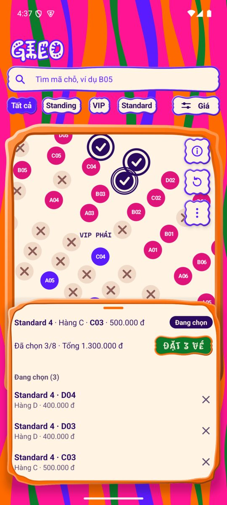
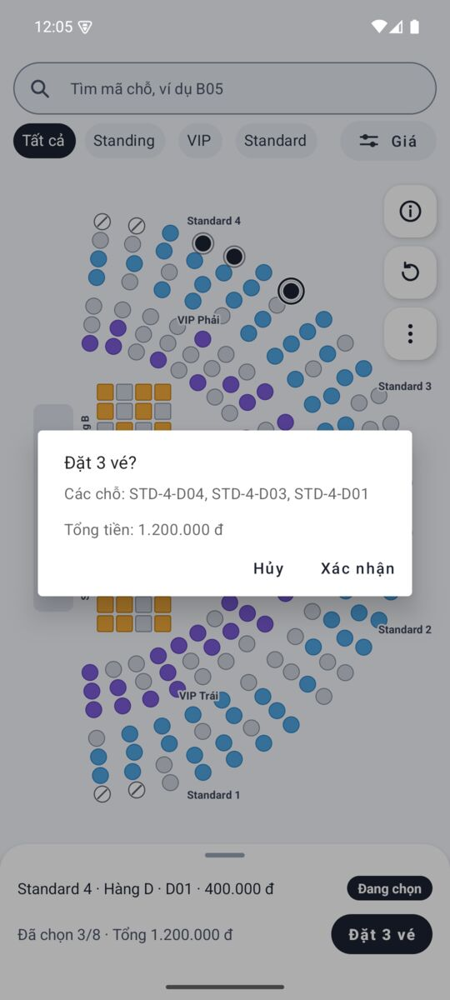

# Concert Seat Map

Ứng dụng Android (Java + XML) hiển thị **sơ đồ chỗ ngồi concert hình móng ngựa** gồm 224 chỗ, vẽ trên **một Canvas duy nhất**. Đây là bài giữa kỳ môn Phát triển ứng dụng di động. Dữ liệu là dữ liệu giả lập, không có API hay cơ sở dữ liệu.

| | |
|---|---|
| Repository | https://github.com/habaodunggithub/Mobile-Midterm-Project |
| Video minh họa | _chưa cập nhật_ |
| Nền tảng | Android 7.0 (API 24) trở lên, `compileSdk`/`targetSdk` 37 |
| Ngôn ngữ | Java 11 + XML Views (không dùng Kotlin, Compose hay thư viện bản đồ/zoom bên thứ ba) |

## 1. Mô tả đề tài

Sơ đồ có sân khấu ở một đầu, hai bãi **Standing** (ô đứng vuông) ngay trước sân khấu, rồi vành cung **VIP** và vành cung **Standard** (ghế tròn) bao quanh. Tổng cộng **224 chỗ** chia thành 9 phân khu:

| Khu | Phân khu | Số chỗ | Hình |
|---|---|---|---|
| Standing | Standing A, Standing B | 48 (2 × 24 ô) | ô đứng vuông |
| VIP | VIP Trái, VIP Giữa, VIP Phải | 72 (3 × 24 ghế) | ghế tròn |
| Standard | Standard 1 đến 4 | 104 (4 × 26 ghế) | ghế tròn |

Mỗi chỗ có một trong năm trạng thái hiển thị: **Còn trống**, **Đang chọn**, **Đã đặt**, **Bị khóa** và **Vé của bạn**. Khoảng 1/3 số chỗ đã có người đặt khi mở app lần đầu, 8 ghế bị khóa ở các cụm cố định.

### Chức năng

| Nhóm | Chức năng |
|---|---|
| Xem sơ đồ | Sơ đồ móng ngựa có phân khu, lối đi và nhãn; bảng chú thích (nút ⓘ) giải thích màu và ký hiệu |
| Điều hướng | Kéo một ngón để **Pan** (có giới hạn biên và quán tính); **Pinch-to-Zoom** quanh tâm hai ngón với mức nhỏ nhất và lớn nhất; xoay sơ đồ bằng hai ngón (tự chỉnh thẳng khi nhấc tay, nút la bàn để về góc mặc định); **Reset View** |
| Chọn chỗ | Chạm để chọn hoặc bỏ chọn, tối đa 8 chỗ; chạm vào chỗ không chọn được thì hiện lý do bằng Snackbar |
| Lọc và tìm kiếm | Theo khu, theo mã chỗ (khớp một phần, không phân biệt hoa thường), "Chỉ chỗ trống", khoảng giá; các tiêu chí kết hợp bằng AND; chỗ ngoài bộ lọc bị làm mờ nhưng lựa chọn được giữ nguyên |
| Bottom Sheet | Thu gọn hiện chỗ đang xem và tóm tắt lựa chọn; mở rộng hiện danh sách "Đang chọn" và "Vé của bạn"; bấm dòng để định vị chỗ trên sơ đồ, bấm ✕ để bỏ chọn; đồng bộ hai chiều với sơ đồ |
| Đặt vé | Nút "Đặt N vé", hộp thoại xác nhận, chỗ đã đặt thành "Vé của bạn" |
| Lưu dữ liệu | Lựa chọn và vé của bạn được lưu bằng `SharedPreferences` và còn lại sau khi tắt hẳn app; nút ⋮ → "Làm mới dữ liệu" để xóa |
| Xoay màn hình | Giữ nguyên chỗ đang xem, bộ lọc, góc nhìn, bảng chú thích, hộp thoại; bố cục riêng cho máy ngang (panel lọc bên trái, bảng chi tiết 420dp) |
| Giao diện "Poster lỏng" | Cả màn hình là poster hồng sen với các dải lỏng cam, xanh lá, tím uốn lượn liên tục; sơ đồ là một miếng sticker có viền cam dày, trên viền có chữ chạy vòng quanh (tên khu và giá thấp nhất); thanh lọc, nút và bảng chi tiết cũng là sticker. Chữ lượn Kablammo cho "SÂN KHẤU" và nút "Đặt N vé", Space Mono cho nhãn |
| Hiệu ứng động | Mở app: chỗ hiện dần từ sân khấu ra. Chọn hoặc bỏ chọn: chỗ nảy lên kèm vòng lan. Chạm chỗ không chọn được: chỗ lắc ngang. Đặt vé xong: các chỗ lần lượt lật sang "Vé của bạn". Chip và nút nảy khi bấm; tổng tiền chạy số. Tắt hết khi người dùng tắt hiệu ứng động của hệ thống |

### Ảnh chụp màn hình

Chụp trên emulator Pixel 6 (Android 15).

| Dọc, mặc định | Dọc, đã zoom, bảng chi tiết mở rộng | Hộp thoại đặt vé |
|:---:|:---:|:---:|
|  |  |  |

Ngang: panel lọc bên trái, bảng chi tiết rộng 420dp ở góc dưới phải, bảng chú thích đang mở, bộ lọc VIP đang bật.


## 2. Hướng dẫn chạy

**Yêu cầu:** Android Studio bản mới (kèm JDK 17 và Android SDK 37), hoặc JDK 17 và Android SDK cài sẵn nếu chạy bằng dòng lệnh. Mã nguồn được biên dịch ở mức Java 11.

**Bằng Android Studio:** mở thư mục dự án (thư mục chứa `settings.gradle.kts`), đợi Gradle đồng bộ, chọn một thiết bị ảo hoặc máy thật (Android 7.0 trở lên), bấm **Run**.

**Bằng dòng lệnh** (trong thư mục dự án; cần `local.properties` trỏ tới Android SDK, Android Studio tự tạo file này):

```bash
./gradlew assembleDebug    # build, ra app/build/outputs/apk/debug/app-debug.apk
./gradlew installDebug     # cài lên thiết bị hoặc emulator đang kết nối
./gradlew test             # chạy unit test JUnit trên JVM
./gradlew lint             # kiểm tra lint
```

**Cách thao tác:**

- Kéo một ngón: di chuyển sơ đồ. Vuốt nhanh rồi thả: sơ đồ trượt tiếp.
- Hai ngón chụm hoặc nở: zoom. Xoay hai ngón: xoay sơ đồ. Nút ⟲: Reset View. Nút la bàn (hiện khi sơ đồ lệch góc): về góc mặc định.
- Chạm vào chỗ: chọn hoặc bỏ chọn. Kéo bảng chi tiết ở đáy lên hoặc bấm phần đầu để mở rộng.
- Nút ⓘ: bảng chú thích. Nút ⋮: "Làm mới dữ liệu".

## 3. Kiến trúc mã nguồn

Dữ liệu đi một chiều và phụ thuộc chỉ đi xuống: `ui/` → `map/`, `storage/` → `state/` → `model/`. Các package `model`, `data`, `state` và các lớp tính toán của `map` là **Java thuần** (không import `android.*`) nên test được bằng JUnit trên JVM.

```
com.example.midtermproject
├── model/    Venue, Section, Spot, ZoneType, SpotKind, SpotStatus, DisplayState, SelectionResult
│             Thực thể bất biến, chỉ là dữ liệu.
├── data/     MockVenueFactory, SpotStatusPolicy
│             Sinh sơ đồ giả lập từ một seed cố định.
├── state/    VenueMapState, SpotFilter, SessionStore, SessionData, SessionCodec
│             Nguồn sự thật duy nhất của phần người dùng thay đổi được. Java thuần.
├── map/      MapCamera, HitTester, RotationTracker, FlingDecay        (Java thuần)
│             VenueMapView, VenueRenderer, SpotRenderer                 (android.*)
│             Camera và hình học thuần; lớp View và lớp vẽ tách riêng.
│             SpotEffects                                               (Java thuần)
│             Mốc thời gian và đường cong hiệu ứng của từng chỗ.
├── decor/    LiquidColumns, TickerText                                 (Java thuần)
│             LiquidPosterView, StickerFrameView                        (android.*)
│             Trang trí: nền poster chuyển động, viền sticker có chữ chạy. Không vẽ chỗ nào.
├── storage/  PrefsSessionStore
│             Hiện thực SessionStore bằng SharedPreferences.
└── ui/       MainActivity, DetailSheet, FilterBar, LegendCard,
              SpotListAdapter, BookingConfirmDialog, ResetDataDialog, PriceFormatter
```

| Lớp | Vai trò |
|---|---|
| `VenueMapView` | Custom View duy nhất vẽ sơ đồ (4 constructor cùng gọi `init()`); lo cử chỉ (pan, zoom, xoay, chạm), animation camera, và chỉ ghép các lớp bên dưới |
| `MapCamera` | Giữ `scale`, `angle`, `tx`, `ty` bằng `float`; pan, zoom, xoay, kẹp biên, fit, đổi tọa độ hai chiều. Không dùng `android.graphics.Matrix` nên test được trên JVM |
| `VenueRenderer`, `SpotRenderer` | Vẽ nền, sân khấu, từng chỗ theo trạng thái, tên phân khu. Mọi `Paint` và `Path` dựng sẵn trong constructor |
| `HitTester` | Tìm chỗ dưới điểm chạm (chỉ hình học) |
| `SpotEffects` | Giữ mốc thời gian của các hiệu ứng trên từng chỗ (mở màn, nảy, lật, rung) và trả về hệ số phóng, độ lệch, tiến độ vòng lan cho mỗi khung hình |
| `LiquidPosterView`, `StickerFrameView` | Hai View trang trí nằm dưới và đè lên mép sơ đồ; hình dải lỏng và nội dung chữ chạy do `LiquidColumns`, `TickerText` tính |
| `VenueMapState` | Lựa chọn, vé của bạn, chỗ đang xem, bộ lọc; mọi thay đổi đi qua các hàm của nó rồi báo `Listener` (mô hình Observer) |
| `DetailSheet`, `FilterBar`, `LegendCard` | Điều khiển các view XML; chỉ đọc từ `VenueMapState`, không giữ bản sao dữ liệu |
| `MainActivity` | Ghép các mảnh, nhận cú chạm từ sơ đồ, lưu và khôi phục trạng thái |

Các quyết định kiến trúc chính:

- **Một Custom View, không có View cho từng chỗ.** `VenueMapView` kế thừa `View` và vẽ cả 224 chỗ trong `onDraw`; phần vẽ tách sang `VenueRenderer`/`SpotRenderer` để View chỉ còn lo cử chỉ và camera.
- **Camera giữ số, không giữ `Matrix`.** Công thức tường minh và test được bằng JUnit; `Matrix` chỉ được dựng lúc vẽ từ `scale`, `angle`, `tx`, `ty`.
- **Cử chỉ:** `GestureDetector` cho kéo một ngón và chạm (`onSingleTapUp`, phản hồi tức thì, không chờ chạm đúp); zoom và xoay hai ngón tự đo, vì `ScaleGestureDetector` chỉ bắt đầu khi hai ngón cách nhau tối thiểu `getScaledMinimumScalingSpan()` (đo được 446px trên emulator Android 15) nên zoom bị trễ rõ rệt.
- **Bottom Sheet:** `CoordinatorLayout` + `BottomSheetBehavior` (persistent sheet, sơ đồ vẫn chạm được khi sheet mở). Hai hộp thoại xác nhận là `DialogFragment` nên `FragmentManager` tự tạo lại sau khi xoay.
- **Trang trí tách khỏi sơ đồ.** Nền poster và viền sticker là hai View riêng trong package `decor/`, không phải là chỗ, nên không vi phạm yêu cầu "mọi chỗ vẽ bởi một Custom View". `VenueMapView` vẫn chỉ vẽ sân khấu và 224 chỗ; sơ đồ lùi vào 16dp để mép nằm khuất dưới viền, chạm lên viền không lọt xuống sơ đồ.
- **Bố cục dọc và ngang** dùng chung các file include (`view_map_layers`, `view_bottom_sheet`, `view_price_controls`, `view_filter_status`) với **cùng bộ id**, nên `MainActivity` không cần biết hướng màn hình. `layout-land/` chỉ khác ở vị trí các khối.

## 4. Cách tổ chức dữ liệu

### Mô hình (bất biến)

| Lớp | Thuộc tính chính |
|---|---|
| `Venue` | kích thước sơ đồ 780 × 520 (đơn vị sơ đồ), hình sân khấu, `List<Section>`, `List<Spot>` (theo thứ tự vẽ), tra cứu theo mã bằng `findSpot(id)` |
| `Section` | `id` (`STA-A`, `VIP-T`, `VIP-G`, `VIP-P`, `STD-1`…`STD-4`), `name`, `zone`, vị trí nhãn `labelX/labelY` |
| `Spot` | `id` (ví dụ `VIP-T-A05`), `sectionId`, `zone`, `kind` (`SEAT` hoặc `STANDING_CELL`), `rowLabel`, `number`, `label` (`A05`, tính sẵn để vẽ), `baseStatus`, `price` (đồng), tâm `cx/cy` và `size` |

Hình học của chỗ lưu bằng `float` thuần (không dùng `RectF` hay `Path`) để chạy được trong JUnit. `Spot.baseStatus` (`AVAILABLE`, `BOOKED`, `LOCKED`) là dữ liệu gốc và **không bao giờ đổi**; trạng thái hiển thị (`DisplayState`) được suy ra từ nó và từ `VenueMapState`:

| Ưu tiên | Điều kiện | Hiển thị |
|---|---|---|
| 1 | có trong vé của bạn | `MINE` (ngôi sao xanh lục) |
| 2 | `baseStatus == BOOKED` | `BOOKED` (xám, dấu ✕) |
| 3 | `baseStatus == LOCKED` | `LOCKED` (nền trắng, gạch chéo) |
| 4 | có trong lựa chọn | `SELECTED` (mực xanh đen, dấu ✓) |
| 5 | còn lại | `AVAILABLE` (màu theo khu) |

Hai lớp phủ độc lập: **ngoài bộ lọc** (vẽ mờ, giữ nguyên hình dạng) và **đang xem** (vòng sáng quanh chỗ). Vì chỉ suy ra, bỏ chọn một chỗ thì nó tự trở về đúng dáng vẻ cũ.

### Dữ liệu giả lập

`MockVenueFactory.create()` dựng cùng một sơ đồ mỗi lần (seed `2026`):

- **Standing:** hai khối 4 hàng × 6 ô, bước 24 đơn vị. **VIP:** 3 phân khu × 3 hàng × 8 ghế. **Standard:** 4 phân khu × 4 hàng (6, 6, 7, 7 ghế). Ghế xếp trên vành cung hơi oval quanh tâm mép dưới sân khấu: `x = cx0 + 0,9·r·cosθ`, `y = cy0 + 1,04·r·sinθ`; hàng A gần sân khấu nhất.
- **Giá theo khu và hàng** (gần sân khấu thì đắt hơn): Standing 1,2 → 0,9 triệu; VIP 2,5 → 1,9 triệu; Standard 0,7 → 0,4 triệu.
- **Trạng thái gốc:** 8 ghế `LOCKED` ở các cụm cố định (VIP Giữa hàng C ghế 3–6, Standard 1 hàng D ghế 1–2, Standard 4 hàng D ghế 6–7); các chỗ còn lại bốc bằng `new Random(2026)`, ngưỡng 0,34 cho `BOOKED` (khoảng 1/3 số chỗ, trong khoảng 60 đến 90).
- `MockVenueFactoryTest` kiểm: đúng 224 chỗ, mã không trùng, không hai chỗ chồng nhau, mọi chỗ nằm trong sơ đồ, hai lần gọi cho cùng kết quả.

### Dữ liệu lưu giữa các lần mở app

Chỉ có **lựa chọn** (giữ thứ tự chọn) và **vé của bạn**, ghi bằng `SharedPreferences` (tệp `venue_session`) qua `SessionStore`:

| Khóa | Kiểu | Ví dụ |
|---|---|---|
| `selected_ids` | `String`, mã nối bằng dấu phẩy | `"VIP-T-A05,STD-2-D07"` |
| `my_ticket_ids` | `String` | `"STA-A-A01"` |

Dùng chuỗi nối thay vì `StringSet` vì `StringSet` không giữ thứ tự mà lựa chọn cần giữ thứ tự chọn. Ghi bằng `apply()` nên không chặn giao diện. Dữ liệu đọc lên (có thể cũ hoặc hỏng) luôn đi qua `VenueMapState.restore`, hàm này bỏ mã không tồn tại, mã trùng, chỗ không còn trống và chỗ vừa chọn vừa là vé, nên app không crash vì dữ liệu hỏng.

## 5. Công thức chuyển đổi tọa độ

Có hai hệ tọa độ: **tọa độ sơ đồ** (world, đơn vị riêng, gốc ở góc trên trái của sơ đồ 780 × 520, trục y hướng xuống) và **tọa độ màn hình** (px của `VenueMapView`). Quy ước: góc dương là **theo chiều kim đồng hồ trên màn hình**, giống `Matrix.postRotate` của Android.

`MapCamera` giữ bốn số: tỉ lệ `s`, góc `θ` (radian) và độ dịch `t = (tx, ty)` (px). Phép biến đổi:

```
screen = s · R(θ) · world + t         R(θ) = [ cosθ  −sinθ ]
                                             [ sinθ   cosθ ]

world  = R(−θ) · (screen − t) / s     (chiều ngược lại, dùng khi chạm)
```

Trong code (`MapCamera.worldToScreenX/Y` và `screenToWorldX/Y`), hai chiều đều cần **cả hai tọa độ** vì có xoay:

```java
screenX = s * (wx * cosθ - wy * sinθ) + tx;
screenY = s * (wx * sinθ + wy * cosθ) + ty;

dx = (sx - tx) / s;  dy = (sy - ty) / s;
worldX =  dx * cosθ + dy * sinθ;
worldY = -dx * sinθ + dy * cosθ;
```

Khi vẽ, `VenueMapView` dựng `Matrix` từ chính bốn số này (`setScale(s, s)`, `postRotate(θ°)`, `postTranslate(tx, ty)`) rồi `canvas.concat(matrix)`. Vì hit-test và việc vẽ dùng chung một công thức nên không thể lệch nhau.

| Thao tác | Công thức | Ý nghĩa |
|---|---|---|
| **Pan** | `t' = t + (dx, dy)`, rồi kẹp biên | kéo bao nhiêu px thì dịch bấy nhiêu |
| **Zoom** hệ số `k` quanh điểm `f` | `s' = clamp(s·k)`, `t' = f − (s'/s)·(f − t)` | điểm sơ đồ nằm dưới `f` (tâm hai ngón) đứng yên |
| **Xoay** góc `Δ` quanh `f` | `θ' = θ + Δ`, `t' = f − R(Δ)·(f − t)` | điểm sơ đồ dưới `f` đứng yên |
| **Fit** | `min((W − 2p)/Wθ, (H − bottomInset − 2p)/Hθ)`, `p = 16dp` | sơ đồ vừa vùng nhìn ở góc `θ`; `Wθ = W|cosθ| + H|sinθ|`, `Hθ = W|sinθ| + H|cosθ|` là khung bao của sơ đồ đã xoay |
| **Giới hạn zoom** | nhỏ nhất = Fit tại góc hiện tại, lớn nhất = `6 ×` Fit tại góc mặc định | tại mức lớn nhất một ghế to khoảng 42dp |
| **Kẹp biên** | mép khung bao chỉ được lùi vào trong mép vùng nhìn tối đa 48dp | không kéo sơ đồ ra khỏi màn hình; nếu khung bao nhỏ hơn vùng nhìn thì căn giữa |

Góc mặc định là `−90°` khi màn hình dọc (sân khấu bên trái, để sơ đồ lấp đầy chiều cao) và `0°` khi ngang (sân khấu ở trên). `bottomInset` là chiều cao bảng chi tiết đang thu gọn: sơ đồ được căn giữa phía trên bảng.

Xoay hai ngón dùng `RotationTracker` (Java thuần): từ hai điểm chạm tính góc đường nối bằng `atan2`, trả độ lệch so với lần trước, chuẩn hóa về `(−π, π]` để không nhảy 360° khi đi qua trục ±180°. Sơ đồ chỉ bắt đầu xoay khi đường nối quay quá 6°, và tự chỉnh thẳng nếu nhấc tay trong ±8° quanh một góc vuông.

## 6. Phương pháp hit-testing

Khi người dùng chạm, `VenueMapView.handleTap` làm ba bước:

1. Đổi điểm chạm từ màn hình sang tọa độ sơ đồ bằng `MapCamera.screenToWorldX/Y` (công thức ngược ở mục 5, đã tính cả pan, zoom và xoay hiện tại).
2. Tính dung sai bằng **dp rồi chia cho tỉ lệ**: `tolerance = 8dp · density / s`. Chia cho `s` để vùng nới luôn là 8dp trên màn hình ở mọi mức zoom (nếu quên thì khi zoom lớn vùng nới phình ra gấp nhiều lần và chạm lệch vẫn "trúng").
3. `HitTester.findSpotAt` duyệt các chỗ, dùng `Spot.hitTest`:

```java
dx = wx - cx;  dy = wy - cy;  reach = size + tolerance;
ghế tròn:   dx*dx + dy*dy <= reach*reach     // khoảng cách tới tâm
ô đứng:     |dx| <= reach && |dy| <= reach   // ô vuông không xoay trong tọa độ sơ đồ
```

Nếu điểm chạm nằm trong vùng của nhiều chỗ (ở mức Fit, vùng đã nới của các chỗ kề nhau chồng lên nhau) thì chọn chỗ có **tâm gần điểm chạm nhất**. Không trúng chỗ nào (lối đi, sân khấu) thì báo "chạm vào chỗ trống" và bỏ chỗ đang xem.

Vì hit-test làm trong **tọa độ sơ đồ** sau khi đổi ngược toàn bộ phép biến đổi, ghế vẫn tròn và ô đứng vẫn vuông bất kể sơ đồ đang xoay thế nào, nên hit-test đúng ở mọi góc nhìn chứ không chỉ ở góc mặc định. Bằng chứng nằm ở các test `ac3_9_*`, ví dụ `HitTesterTest.ac3_9_correctAfterPanAndZoom` và `ac3_9_correctAfterZoomAroundAnOffCenterFocusAndRotation`: với 3 góc xoay (0°, −90°, 37°), 3 mức zoom và 4 độ pan (36 cấu hình), mọi chỗ đang nằm trong màn hình được chạm lệch tâm 6 hướng (cách tâm 0,45 bán kính trên màn hình) và phải trả về đúng chỗ đó.

`HitTester` chỉ làm hình học, xét **mọi** chỗ. Việc được phép chọn hay không (chỗ đã đặt, bị khóa, ngoài bộ lọc, quá 8 chỗ) là quy tắc nghiệp vụ nằm trong `VenueMapState.toggleSelection`, nên chạm vào chỗ không chọn được vẫn nhận ra chỗ đó để báo lý do.

## 7. Quản lý trạng thái

**Tách ba lớp:** dữ liệu (`model/`, `data/`: sơ đồ bất biến), trạng thái (`state/`: phần người dùng thay đổi) và lớp vẽ (`map/`, `ui/`). Dữ liệu đi một chiều: *chạm → `VenueMapState` → báo `Listener` → sơ đồ và bảng chi tiết cùng vẽ lại*. Sơ đồ, bộ lọc và bảng chi tiết **chỉ đọc** từ state, không giữ bản sao riêng, nên chúng không thể lệch nhau (đồng bộ hai chiều).

`VenueMapState` giữ: các chỗ đang chọn (`LinkedHashSet`, giữ thứ tự chọn, tối đa 8), vé của bạn, chỗ đang xem và bộ lọc (`SpotFilter` bất biến, mỗi lần đổi tạo bản mới). Mọi thay đổi đi qua các hàm lệnh `toggleSelection`, `removeSelection`, `setFocused`, `setFilter`, `bookSelection`, `restore`, `resetAll`; mỗi hàm báo `Listener` đúng một lần. Các bất biến luôn đúng: lựa chọn và vé không giao nhau; chỗ đã chọn đều có trạng thái gốc `AVAILABLE`; không quá 8 chỗ; chỗ đang xem là `null` hoặc có thật.

Quy tắc chọn nằm trong `toggleSelection`, trả về `SelectionResult` để giao diện báo lý do: vé của bạn, đã đặt, bị khóa, ngoài bộ lọc, hoặc đã đủ 8 chỗ (chỉ bỏ chọn được qua nút ✕ trong bảng chi tiết nếu chỗ đã ra ngoài bộ lọc). Chạm vào chỗ không chọn được thì chỗ đó vẫn thành "chỗ đang xem".

### Giữ trạng thái khi xoay màn hình

Mỗi dữ liệu chỉ có **một nguồn**:

| Dữ liệu | Nơi giữ | Vì sao |
|---|---|---|
| Lựa chọn (giữ thứ tự) và vé của bạn | `SharedPreferences` qua `SessionStore`, ghi mỗi khi một trong hai đổi | còn lại cả khi tắt hẳn app (AC-7.5) |
| Chỗ đang xem, bộ lọc, ảnh chụp góc nhìn, bảng chú thích | `Bundle` trong `onSaveInstanceState` | chỉ cần qua xoay màn hình và khi hệ thống hủy Activity |
| Bảng chi tiết mở rộng hay thu gọn | `BottomSheetBehavior` tự lưu | |
| Hộp thoại xác nhận | `FragmentManager` dựng lại từ `arguments` | |

`onCreate` sinh lại sơ đồ từ cùng seed, đọc `SessionStore`, lấy thêm chỗ đang xem và bộ lọc từ `Bundle` (nếu có), rồi gọi `VenueMapState.restore` **đúng một lần**; hàm này loại mọi mã sai nên dữ liệu hỏng không làm app crash. Các control lọc được vẽ từ state, và đặt `android:saveEnabled="false"` để Android không tự khôi phục chip, chữ tìm kiếm, công tắc, thanh giá bằng giá trị cũ (nếu không thì bộ lọc có hai nguồn).

**Góc nhìn** được lưu dưới dạng `{điểm sơ đồ ở tâm vùng nhìn (x, y), tỉ lệ so với Fit}`, **không lưu `tx, ty` thô**, vì sau khi xoay máy kích thước vùng nhìn đã khác: cùng một `tx, ty` sẽ chỉ vào chỗ khác. Góc xoay không lưu, sau khi tạo lại sơ đồ về góc mặc định của hướng mới. `VenueMapView` áp ảnh chụp ngay khi đo xong kích thước; ảnh hỏng thì dùng Fit.

## 8. Tối ưu hiệu năng

- **Không cấp phát trong `onDraw`:** mọi `Paint`, `Path`, `Matrix`, `RectF` và mảng tạm được dựng sẵn khi khởi tạo (`VenueRenderer`, `SpotRenderer`, `VenueMapView`); nhãn chỗ (`A05`) là `String` tính sẵn trong `Spot`; không nối chuỗi hay `String.format` lúc vẽ. `./gradlew lint` không có cảnh báo `DrawAllocation`.
- **Chỉ vẽ lại khi cần:** sơ đồ chỉ `invalidate()` khi camera đổi (cử chỉ, animation), khi `VenueMapState` báo thay đổi, hoặc khi `SpotEffects` còn hiệu ứng đang chạy; animation dùng `postInvalidateOnAnimation()`. Hết hiệu ứng thì sơ đồ đứng yên.
- **Nền chuyển động liên tục** (sinh viên chọn, REQUIREMENTS Q43): `LiquidPosterView` và `StickerFrameView` tự vẽ lại mỗi khung hình. Hai View này nằm riêng nên khi chúng vẽ lại, phần cứng chỉ ghi lại hình của chúng, không gọi lại `onDraw` của sơ đồ. Chúng cũng không cấp phát trong `onDraw` (mảng mép dải cấp trong `onSizeChanged`, chữ chạy dựng một lần). Khi app vào nền, hệ thống ngừng vẽ nên vòng lặp tự dừng; khi người dùng tắt hiệu ứng động của hệ thống, cả hai đứng yên và không hẹn khung tiếp theo.
- **Culling:** mỗi khung hình `MapCamera.getVisibleWorldBounds` trả về khung bao của vùng nhìn trong tọa độ sơ đồ (bốn góc màn hình đổi ngược về sơ đồ, có tính cả xoay); `VenueRenderer` bỏ qua các chỗ nằm hẳn ngoài khung này (có lề 24dp cho vòng sáng và viền). Khi zoom lớn chỉ còn vài chục chỗ được vẽ.
- **Mức chi tiết (LOD):** mã chỗ, dấu ✓ ✕ ★ chỉ vẽ khi chỗ đủ to trên màn hình (đường kính từ 22dp); gạch chéo của chỗ bị khóa từ 9dp. Ở mức Fit chỉ vẽ hình tròn hoặc vuông.
- **Cắt theo khung:** `onDraw` tự `clipRect` theo khung của View, và chữ tên phân khu vẽ trong tọa độ màn hình nên luôn cùng cỡ.
- **Phần cứng:** vẽ bằng `View` thường nên được tăng tốc bởi GPU; 224 chỗ không cần `SurfaceView`.
- **Số đo** (`dumpsys gfxinfo`, emulator Pixel 6 API 35, pinch và pan liên tục 5 vòng, 390 khung hình): trung vị 16 ms, 90% dưới 23 ms, 99% dưới 32 ms; 80% số khung trong 17 ms; thời gian GPU trung vị 11 ms. Đây là số đo trên emulator (GPU giả lập), chưa đo trên máy thật.

## 9. Nhật ký sử dụng AI Agent

Dự án được làm với trợ lý lập trình **Claude Code** (Anthropic). Quy trình: viết yêu cầu và kế hoạch trước (đặc tả, tiêu chí chấp nhận, quyết định kiến trúc), hỏi sinh viên mọi quyết định có nhiều lựa chọn hợp lý, rồi làm từng mảnh nhỏ: viết code, build và test xanh, rồi commit. Mỗi commit làm đúng một việc kỹ thuật. AI không push và không ghi công trong commit; việc dùng AI chỉ được ghi ở đây. Dòng "Sinh viên kiểm tra/điều chỉnh" ở mỗi phiên do sinh viên tự điền.

### 2026-11-25: lập kế hoạch và Chặng 1

- **Agent/model:** Claude Code (Claude Opus 5.5, sau đó Claude Sonnet 5.5).
- **Nhiệm vụ được giao:** đọc đề và tài liệu môn học, viết `CLAUDE.md`, `REQUIREMENTS.md`, `PLAN.md` (đều nằm ngoài repo); làm Chặng 1: mô hình dữ liệu và sơ đồ giả lập.
- **Code được sinh:** `model/` (`ZoneType`, `SpotKind`, `SpotStatus`, `Spot`, `Section`, `Venue`), `data/` (`SpotStatusPolicy`, `MockVenueFactory`) và các test `SpotTest`, `VenueTest`, `SpotStatusPolicyTest`, `MockVenueFactoryTest` (12 commit).
- **Lỗi hoặc hạn chế của kết quả AI:**
  - Hình học vòng cung (bán kính, góc từng phân khu) do AI tự tính. Mới chỉ được kiểm bằng test không chồng lấn và nằm trong sơ đồ, chưa được nhìn trên màn hình vì chưa có phần vẽ.
  - Gradle không chạy được ở chế độ offline (thiếu `aapt2`), phải chạy có mạng để tải.
- **Sinh viên kiểm tra/điều chỉnh:** Đã chốt sơ đồ móng ngựa với ô Standing hình vuông và ghế VIP, Standard hình tròn. Khi rà soát dữ liệu giả lập, đã đối chiếu các test về tổng số 224 chỗ, mã chỗ duy nhất và vị trí của 8 ghế bị khóa.

### 2026-11-25 (tiếp): thiết kế giao diện và làm lại hình học (Chặng 1B)

- **Agent/model:** Claude Code (Claude Sonnet 5.5), có dùng hai skill `ui-ux-pro-max` và `huashu-design`.
- **Nhiệm vụ được giao:** đề xuất ba hướng thiết kế giao diện (A Tonal, B Mực in, C Bảng pad) dựa trên dữ liệu thật; so sánh ba phương án hình học để ghế to hơn ở mức Fit; làm lại hình học trong `MockVenueFactory`.
- **Code được sinh/sửa:** `MockVenueFactory` (hằng số bố cục gom lại, hệ số oval, thông số mới: sơ đồ 780 × 520), `MockVenueFactoryTest` (6 test mới, các test cũ đọc hằng số thay vì số cứng). 4 commit.
- **Lỗi hoặc hạn chế của kết quả AI:**
  - Ở bản xem trước đầu tiên, AI chọn nhầm một ghế đã đặt làm ghế "đang chọn". Phát hiện khi xem ảnh chụp, đã sửa.
  - Thông số hình học mới do script tìm kiếm của AI chọn (kiểm không chồng lấn); chưa được nhìn trên emulator vì chưa có phần vẽ trong app.
  - Quy trình `huashu-design` được rút gọn (3 thẻ hướng thay vì 6; chưa chụp ảnh tham chiếu thật).
- **Sinh viên kiểm tra/điều chỉnh:** Sau khi so sánh các phương án, đã chọn thu gọn sơ đồ còn 780 × 520 và chỉnh vành ghế thành hình oval nhẹ để ghế dễ nhìn hơn ở mức Fit. Đã rà lại các test về khoảng hở giữa ghế và lối đi giữa các phân khu sau khi đổi bố cục.

### 2026-11-25 (tiếp): Chặng 2, vẽ sơ đồ bằng Canvas

- **Agent/model:** Claude Code (Claude Sonnet 5.5), có dùng hai skill `ui-ux-pro-max` (kiểm tương phản màu, khoảng cách vùng chạm) và `huashu-design` (vòng đánh giá ảnh chụp). AI tự tạo emulator Pixel 6 (Android 35), cài APK và chụp màn hình để kiểm.
- **Nhiệm vụ được giao:** vẽ toàn bộ sơ đồ trên một Custom View theo hướng thiết kế A, gồm màu và chuỗi tiếng Việt, theme sáng, `SpotRenderer`, `VenueRenderer`, `MapCamera` (fit và góc mặc định), `VenueMapView`, `MainActivity`.
- **Code được sinh/sửa:** `res/values/{colors,strings,themes}.xml`, `DisplayState`, `SpotRenderer`, `SpotStateSource`, `VenueRenderer`, `MapCamera`, `MapCameraTest`, `VenueMapView`, `MainActivity`, `activity_main.xml`, `AndroidManifest.xml` (10 commit).
- **Lỗi hoặc hạn chế của kết quả AI:**
  - Lần chạy đầu, tên bãi Standing (chữ nằm ngang) đè lên ô đứng khi sơ đồ xoay dọc, và ghế bị khóa chỉ là vòng trắng ở mức Fit. Phát hiện khi xem ảnh chụp emulator; đã sửa bằng cách vẽ tên bãi trong tọa độ sơ đồ và hiện gạch chéo sớm hơn.
  - Một số màu trong bản thiết kế xem trước chỉ đạt tương phản 1,4–2,5:1 so với nền; AI thêm viền đậm hơn cho từng khu để đạt 3:1.
  - Tên phân khu VIP/Standard vẫn đè lên vài ghế ở mức Fit (có viền sáng quanh chữ); chấp nhận ở bản này.
  - Dữ liệu trạng thái hiển thị là dữ liệu mẫu tạm, sẽ gỡ ở Chặng 4.
- **Sinh viên kiểm tra/điều chỉnh:** Đã duyệt giao diện sáng theo phương án Tonal và màu riêng cho từng khu. Khi rà lại cách vẽ ở mức Fit, đã ghi nhận nhãn Standing chồng lên ô đứng và vạch chéo của ghế bị khóa chưa hiện rõ để điều chỉnh.

### 2026-11-25 (tiếp): Chặng 3, pan, zoom, xoay, la bàn, quán tính

- **Agent/model:** Claude Code (Claude Sonnet 5.5). AI tự viết một bài kiểm thử tạm trong `androidTest` (không commit) để bơm cử chỉ hai ngón vào emulator, đọc số liệu camera và chụp màn hình.
- **Nhiệm vụ được giao:** camera có pan giới hạn biên, zoom quanh tâm hai ngón, xoay hai ngón có ngưỡng 6°, tự dính góc vuông, nút la bàn, snapshot, quán tính khi vuốt (18 commit).
- **Code được sinh/sửa:** `MapCamera` (panBy, zoomBy, rotateBy, clamp theo khung bao, nearestRightAngle, snapshot), `RotationTracker`, `FlingDecay`, `VenueMapView` (cử chỉ, animator), `MainActivity` và layout/drawable cho nút la bàn; `MapCameraTest`, `RotationTrackerTest`, `FlingDecayTest` (116 test đơn vị cho cả dự án).
- **Lỗi hoặc hạn chế của kết quả AI:**
  - Kế hoạch dùng `ScaleGestureDetector` nhưng nó không bắt đầu zoom nếu hai ngón cách nhau dưới 446px trên emulator; AI phát hiện khi đọc log số liệu và thay bằng cách tự đo khoảng cách hai ngón.
  - Mã ghế và ký hiệu ✓ ✕ ★ ban đầu xoay theo sơ đồ nên nằm ngang khi dọc; phát hiện qua ảnh chụp, đã sửa.
  - Vài test đầu tiên sai ở chỗ AI chọn mức zoom quá nhỏ làm sơ đồ bị căn giữa (đúng theo yêu cầu), nên phải sửa lại cách dựng tình huống thử.
  - Cử chỉ được kiểm bằng sự kiện cảm ứng mô phỏng trên emulator, chưa thử trên điện thoại thật.
- **Sinh viên kiểm tra/điều chỉnh:** Đã chốt mức zoom tối đa gấp 6 lần mức Fit, ngưỡng xoay 6° và thao tác vuốt có quán tính. Đã rà lại các test về giữ điểm dưới tâm hai ngón khi zoom, kẹp biên khi kéo và tính góc vuông gần nhất để tự căn khi nhấc tay.

### 2026-11-25 (tiếp): Chặng 4, chạm chọn và trạng thái

- **Agent/model:** Claude Code (Claude Sonnet 5.5). AI viết bài thử tạm trong `androidTest` (không commit) để bơm cú chạm thật vào emulator.
- **Nhiệm vụ được giao:** hit-testing đúng sau pan, zoom, xoay; `SpotFilter` bốn tiêu chí; `VenueMapState` là nguồn dữ liệu duy nhất; nối chạm chọn, thông báo lý do và rung nhẹ vào `MainActivity` (14 commit).
- **Code được sinh/sửa:** `SelectionResult`, `Spot` (hitTest, searchKey), `HitTester`, `SpotFilter`, `VenueMapState`, `VenueMapStateSource`, `VenueMapView` (nhận cú chạm), `MainActivity`; `HitTesterTest`, `SpotFilterTest`, `VenueMapStateTest` (179 test đơn vị cho cả dự án).
- **Lỗi hoặc hạn chế của kết quả AI:**
  - Bản đầu để `GestureDetector` nhận diện chạm đúp, làm lần chạm thứ hai gần lần đầu bị mất; chỉ phát hiện khi chạy trên emulator, đã tắt.
  - Cảnh báo lint `ClickableViewAccessibility` được tắt có chú thích (đã gọi `performClick()` khi nhận ra cú chạm) thay vì thay đổi cách xử lý chạm.
  - Cú chạm được kiểm bằng sự kiện mô phỏng trên emulator, chưa thử bằng ngón tay thật.
- **Sinh viên kiểm tra/điều chỉnh:** Đã chốt giới hạn 8 chỗ và yêu cầu vẫn hiện chi tiết kèm lý do khi chạm vào chỗ không chọn được. Đã đối chiếu các test cho trường hợp chọn chỗ thứ 9, chạm ghế đã đặt hoặc bị khóa, và chạm gần mép ghế sau khi kéo, zoom và xoay.

### 2026-11-25 (tiếp): Chặng 5, bảng chi tiết và đồng bộ hai chiều

- **Agent/model:** Claude Code (Claude Sonnet 5.5). Dùng hai skill UX/UI (`ui-ux-pro-max`, `huashu-design`) để kiểm vùng chạm 48dp, độ tương phản các chip trạng thái và cách thay thế cho thao tác kéo; kiểm trên emulator bằng `adb input tap`, `uiautomator dump` và ảnh chụp.
- **Nhiệm vụ được giao:** bảng chi tiết thu gọn/mở rộng (chỗ đang xem, tóm tắt, danh sách đang chọn có ✕), bấm dòng để định vị có vòng sáng nhấp nháy, giữ đồng bộ hai chiều qua `VenueMapState` (8 commit).
- **Code được sinh/sửa:** `PriceFormatter`, `MapCamera.centerOnTarget`, `VenueMapView.locateSpot` và hiệu ứng nhấp nháy, `SpotRenderer`/`VenueRenderer` (tham số `pulse`), `DetailSheet`, `SpotListAdapter`, `MainActivity`, `activity_main.xml`, `item_spot.xml` và các layout/drawable/chuỗi/màu đi kèm; `PriceFormatterTest`, thêm 8 test vào `MapCameraTest` (193 test đơn vị cho cả dự án).
- **Lỗi hoặc hạn chế của kết quả AI:**
  - Bảng biến mất khỏi màn hình ở lần chạy đầu vì AI đặt `layout_gravity="bottom"`, rồi lại lệch đúng 128px vì `CoordinatorLayout` có padding thanh trạng thái; cả hai chỉ thấy khi xem ảnh chụp emulator.
  - `PriceFormatter` ban đầu dùng `Math.abs` nên sai với `Long.MIN_VALUE`; test biên phát hiện và đã sửa.
  - Sau khi xoay máy, danh sách bị ẩn khi bảng được khôi phục ở trạng thái mở rộng; AI phát hiện qua ảnh chụp ngang và sửa.
  - Vòng sáng nhấp nháy ban đầu nở quá ít để thấy được ở mức zoom 2,5×; AI tăng biên độ sau khi so khung hình.
  - Bố cục ngang chưa tối ưu (bảng thu gọn chiếm 29% chiều cao), để dành cho Chặng 8.
  - Hiệu ứng chỉ được kiểm bằng ảnh chụp trên emulator, chưa thử bằng ngón tay thật.
- **Sinh viên kiểm tra/điều chỉnh:** Đã chọn cách tự thu gọn bảng khi bấm vào một dòng để người dùng thấy chỗ vừa được định vị. Đã rà lại cách danh sách cập nhật khi chọn ghế trên sơ đồ và cách ghế trở về trạng thái còn trống khi bấm ✕ trong danh sách.

### 2026-11-25 (tiếp): Chặng 6, legend, bộ lọc, Reset View

- **Agent/model:** Claude Code (Claude Sonnet 5.5). Dùng hai skill UX/UI (`ui-ux-pro-max`, `huashu-design`) để kiểm vùng chạm 48dp, độ tương phản và cách xếp thẻ nổi; bố cục các nút bám bản xem trước đã duyệt ở Chặng 2. Kiểm trên emulator bằng `adb input`, `sendevent` (pinch), `uiautomator dump` và ảnh chụp, cả dọc lẫn ngang.
- **Nhiệm vụ được giao:** nút Reset View; bảng chú thích mở bằng nút ⓘ; thanh lọc (ô tìm kiếm, chip khu, "Chỉ chỗ trống", thanh khoảng giá); dòng "Đang lọc" kèm Xóa lọc; thông báo không có kết quả (M7); panel lọc ở bố cục ngang (16 commit, gồm 7 commit sửa lỗi hoặc tách bố cục thêm ngoài danh sách đầu chặng).
- **Code được sinh/sửa:** `PriceFormatter.formatMillions` (+ 4 test), `LegendCard`, `FilterBar`, `VenueMapView` (`resetView`, `onDraw` tự cắt theo khung), `MainActivity`; `activity_main.xml` và `layout-land/` cùng các file include `view_map_layers`, `view_price_controls`, `view_filter_status`, `view_bottom_sheet`, `view_filter_bar`; 11 drawable mẫu cho legend, các icon, `values/dimens`, `integers`, `themes`, `colors`, `strings` (197 test đơn vị cho cả dự án).
- **Lỗi hoặc hạn chế của kết quả AI:**
  - Thẻ chú thích không chặn chạm nên chạm lên thẻ chọn nhầm chỗ nằm dưới; phát hiện bằng cách chạm thử trên emulator, đã sửa.
  - Khi sửa bóng đổ bị cắt bằng `clipChildren=false`, nền sơ đồ (`drawColor`) tô đè lên thanh lọc phía trên và thanh lọc biến mất. AI chỉ phát hiện sau vài commit vì lúc kiểm đã cắt ảnh chụp bỏ mất phần đầu màn hình; sửa bằng `clipRect` trong `VenueMapView.onDraw` (một commit sửa lỗi riêng). Bản thân commit sửa bóng đổ vẫn để lại thanh lọc ẩn nếu chạy riêng.
  - `clearFocus()` không làm ô tìm kiếm bỏ focus ở panel ngang (ScrollView trả focus về ô đó); phát hiện qua `uiautomator dump`, đã chuyển focus sang khung thanh lọc.
  - Một bước ghi tạm đã chèn một dòng import không có thật vào `FilterBar.java`; AI ghi đè cả file ngay sau đó trước khi build, không vào commit nào.
  - Bố cục ngang còn cramped: bảng chi tiết thu gọn che gần 30% chiều cao nên thanh giá bị che một phần, để dành cho Chặng 8. Android còn tự khôi phục chip và chữ ô tìm kiếm khi Activity bị tạo lại; Chặng 8 phải chặn và lưu qua `Bundle`.
  - Mọi thao tác chỉ được kiểm bằng sự kiện mô phỏng trên emulator, chưa thử bằng ngón tay thật; phím Enter của bàn phím cứng không kích hoạt "tìm" vì code chỉ xử lý `IME_ACTION_SEARCH`.
- **Sinh viên kiểm tra/điều chỉnh:** Đã chọn dùng thẻ nổi cho phần lọc giá và dòng “Đang lọc” ở màn hình dọc để giữ nguyên góc nhìn. Ở màn hình ngang, đã chuyển các điều khiển lọc sang cột trái. Đã rà lại thao tác xóa bộ lọc, việc giữ các chỗ đang chọn khi đổi điều kiện lọc và vị trí nút Reset View.

### 2026-11-25 (tiếp): Chặng 7, đặt vé, lưu bền, làm mới dữ liệu

- **Agent/model:** Claude Code (Claude Sonnet 5.5). Dùng hai skill UX/UI (`ui-ux-pro-max`, `huashu-design`) để chọn vị trí hai nút (hành động chính nằm trong tầm tay, hành động phá hủy đặt xa và qua menu); hỏi sinh viên bằng bản xem trước ASCII (Q38, Q39). Kiểm trên emulator bằng `adb input`, `uiautomator dump`, `force-stop`, `pm clear` và ảnh chụp, cả dọc lẫn ngang.
- **Nhiệm vụ được giao:** nút "Đặt N vé" và hộp thoại xác nhận (M6); lưu lựa chọn và vé bằng SharedPreferences, khôi phục khi mở lại app; "Làm mới dữ liệu" qua menu ⋮ kèm hộp thoại xác nhận (M10) (16 commit đúng danh sách đã duyệt).
- **Code được sinh/sửa:** `VenueMapState.bookSelection/resetAll`, `SessionCodec`, `SessionData`, `SessionStore`, `PrefsSessionStore`, `BookingConfirmDialog`, `ResetDataDialog`, `DetailSheet`, `MainActivity`, `view_bottom_sheet.xml`, `view_map_layers.xml`, `ic_more_vert.xml`, `menu_map_more.xml`, `themes`/`strings`; `VenueMapStateTest` (thêm 9 test), `SessionCodecTest` (5 test), tổng 211 test đơn vị.
- **Lỗi hoặc hạn chế của kết quả AI:**
  - Nút trong hai hộp thoại hiện chữ HOA ("HỦY", "XÁC NHẬN") do style mặc định của Material, lệch với REQUIREMENTS ("Hủy", "Xác nhận"); AI phát hiện qua ảnh chụp nhưng chưa sửa vì sẽ cần thêm một commit ngoài danh sách đã duyệt.
  - Giữa commit "add book button" và commit "confirm and book" nút Đặt vé tạm chưa làm gì; chỉ là trạng thái trung gian của lịch sử commit, bản cuối đầy đủ.
  - Xoay màn hình vẫn mất chỗ đang xem, bộ lọc và góc nhìn (để Chặng 8); lựa chọn và vé thì giữ nhờ lưu bền.
  - Mọi thao tác chỉ được kiểm bằng sự kiện mô phỏng trên emulator, chưa thử bằng ngón tay thật.
- **Sinh viên kiểm tra/điều chỉnh:** Đã chọn đặt nút “Đặt N vé” cạnh dòng tóm tắt và đưa “Làm mới dữ liệu” vào menu ⋮, có hộp thoại xác nhận. Đã rà lại luồng chuyển chỗ đang chọn thành “Vé của bạn”, cách lưu và khôi phục dữ liệu khi mở lại ứng dụng, và việc xóa dữ liệu sau khi xác nhận.

### 2026-11-25 (tiếp): Chặng 8, xoay màn hình, bố cục ngang, hiệu năng

- **Agent/model:** Claude Code (Claude Sonnet 5.5). Hỏi sinh viên về bố cục bảng chi tiết ở máy ngang (Q40) và chữ nút hộp thoại (Q41); kiểm trên emulator bằng `adb`, `sendevent` (pinch), `uiautomator dump`, `dumpsys gfxinfo`, `logcat` và ảnh chụp, cả dọc lẫn ngang.
- **Nhiệm vụ được giao:** giữ trạng thái khi xoay máy và khi hệ thống hủy Activity (chỗ đang xem, bộ lọc, góc nhìn, chú thích); bảng chi tiết 420dp ở máy ngang; culling các chỗ ngoài màn hình; đo hiệu năng và lint (10 commit).
- **Code được sinh/sửa:** `MainActivity` (`onSaveInstanceState`, `readFilter`, khôi phục), `VenueMapView` (`getCameraSnapshot`, `setPendingCameraSnapshot`), `MapCamera.getVisibleWorldBounds`, `VenueRenderer` (culling), `FilterBar`, `layout-land/activity_main.xml`, các layout lọc (`saveEnabled=false`), `themes`/`dimens`; thêm 4 test vào `MapCameraTest` (215 test đơn vị cho cả dự án).
- **Lỗi hoặc hạn chế của kết quả AI:**
  - Ghi đè `layout_width` trên `<include>` làm mất `app:layout_behavior` của bảng chi tiết, app crash khi mở ở bất kỳ hướng nào dùng bố cục ngang; AI chỉ thấy khi chạy thử (lần đầu còn tưởng app chưa được mở lại sau khi cài), rồi sửa trước khi commit.
  - Dimen `sheet_max_width` chỉ đặt trong `values-land` làm `lint` báo lỗi `MissingDefaultResource`; AI chỉ phát hiện khi chạy `lint` sau khi đã commit, nên có một commit sửa riêng.
  - Hiệu năng chỉ đo trên emulator (trung vị 16ms, 80% khung ≤17ms), chưa đo trên máy thật; nhiều lệnh xoay máy bằng `adb` bị trễ nên vài lần chụp ảnh nhầm hướng.
  - Chưa làm test JUnit cho việc đọc bộ lọc từ `Bundle` vì nó dùng `android.os.Bundle`.
- **Sinh viên kiểm tra/điều chỉnh:** Đã chốt bảng chi tiết rộng 420dp ở góc dưới bên phải khi xoay ngang và yêu cầu đổi nhãn nút thành “Hủy”, “Xác nhận”. Đã đối chiếu bố cục ngang với ảnh chụp, rà lại cách khôi phục bộ lọc và góc nhìn khi xoay màn hình, đồng thời ghi rõ số đo hiệu năng lấy trên emulator.

### 2026-11-26: Chặng 9, README và hồ sơ nộp

- **Agent/model:** Claude Code (Claude Sonnet 5.5). Kiểm trên emulator bằng `adb` để chụp 4 ảnh minh họa; clone repo vào thư mục mới rồi chạy `./gradlew assembleDebug test` để kiểm bản nộp.
- **Nhiệm vụ được giao:** viết `README.md` đủ các mục bắt buộc của đề (mô tả, hướng dẫn chạy, kiến trúc, tổ chức dữ liệu, công thức tọa độ, hit-testing, quản lý trạng thái, hiệu năng, Nhật ký AI, chỗ cho link video), thêm ảnh chụp, và kiểm các điều kiện nộp (README viết thành từng commit theo mục).
- **Code được sinh/sửa:** không sửa code. Thêm `README.md` và 4 ảnh JPEG nhẹ ở `docs/screenshots/` (tổng khoảng 245KB).
- **Lỗi hoặc hạn chế của kết quả AI:**
  - Một câu trong README mô tả test `ac3_9_correctAfterPanAndZoom` ban đầu sai (nói "4 góc xoay" trong khi test dùng 3 góc, và mô tả điểm chạm không đúng); AI đối chiếu lại với mã test rồi sửa trước khi chốt.
  - Số đo hiệu năng trong README là số đo trên emulator, chưa đo trên máy thật.
  - Lịch sử git có 114 commit nhưng chỉ nằm trên 2 ngày lịch (2026-11-25 và 2026-11-26), trong khi đề yêu cầu commit "phân bổ trong thời gian thực hiện"; AI không và không được sửa ngày commit.
  - Link video chưa có vì video do sinh viên tự quay và tải lên; README đang ghi "chưa cập nhật".
  - Những tiêu chí chấp nhận không có test JUnit (giao diện, xoay màn hình, Reset View, bảng chi tiết) chỉ được kiểm thủ công trên emulator, chưa thử bằng ngón tay thật.
- **Sinh viên kiểm tra/điều chỉnh:** Đã rà lại các mục README theo đề, đối chiếu mô tả hit-testing với mã test và chọn bốn ảnh minh họa các thao tác chính. Đã bổ sung nội dung kiểm tra và điều chỉnh cho từng chặng trong Nhật ký AI. Mục liên kết video còn chờ cập nhật.

### 2026-11-26 (tiếp): nhánh `ui/psychedelic-redesign`, giao diện "Poster lỏng" và hiệu ứng động

- **Agent/model:** Claude Code (Claude Opus 5.5), có dùng hai skill `ui-ux-pro-max` và `huashu-design`. Vẽ bản xem trước bằng HTML (nằm ngoài repo, `design-demos/ui-psychedelic/`), hỏi sinh viên về hướng thiết kế, mức hiệu ứng, font, kiến trúc và danh sách commit (Q42–Q46); kiểm trên emulator bằng `adb`, `sendevent` (pinch, xoay), `uiautomator dump` và ảnh chụp liên tiếp để bắt từng khung hiệu ứng.
- **Nhiệm vụ được giao:** tạo nhánh mới, thiết kế lại giao diện theo bộ ảnh tham chiếu psychedelic của sinh viên, thêm nhiều hiệu ứng thao tác và hiệu ứng động (24 commit code, 2 commit tài liệu, trên nhánh `ui/psychedelic-redesign`, chưa gộp vào `main`).
- **Code được sinh/sửa:** package mới `decor/` (`LiquidColumns`, `TickerText`, `LiquidPosterView`, `StickerFrameView`); `map/SpotEffects` mới; sửa `VenueRenderer` (sân khấu sticker, font, áp hiệu ứng), `SpotRenderer` (vòng lan), `VenueMapView` (mở màn, nảy, lật, rung), `DetailSheet` (tổng tiền chạy số), `MainActivity`; màu, theme, drawable, layout dọc và ngang; font Kablammo và Space Mono kèm giấy phép OFL; thêm `LiquidColumnsTest`, `TickerTextTest`, `SpotEffectsTest` (20 test, cả dự án 235 test).
- **Lỗi hoặc hạn chế của kết quả AI:**
  - Hai loạt bản xem trước đầu bị sinh viên chê ("hơi rối", rồi "thêm đặc trưng mạnh của ref/"); đến loạt thứ ba mới chốt được hướng G.
  - Lúc đầu AI viết `ValueAnimator.areAnimatorsEnabled()` trong `DetailSheet`, hàm này chỉ có từ Android 8 nên app sẽ crash trên Android 7 (minSdk 24). Build vẫn xanh vì `assembleDebug` không chạy lint; AI thấy trước khi commit và đổi sang đọc `Settings.Global`.
  - `TickerText` ban đầu dùng constructor `Locale` đã bị đánh dấu lỗi thời; AI sửa bằng cách amend commit vừa tạo (chưa push).
  - Font Kablammo sau khi cắt còn 426KB, lớn hơn mức 50–150KB AI đã báo khi hỏi sinh viên.
  - Nền và chữ chạy vẽ lại liên tục 60 lần mỗi giây, khác quy tắc hiệu năng ban đầu của dự án ("chỉ vẽ lại khi có thay đổi"); sinh viên đã chọn như vậy (Q43). Chưa đo lại `dumpsys gfxinfo` sau khi đổi giao diện.
  - Cạnh dưới của viền sticker nằm khuất sau bảng chi tiết, khác bản xem trước (ở đó sticker kết thúc phía trên bảng), để không phải đổi cách camera tính vùng nhìn.
  - Ở mức Fit, chỗ "Đã đặt" (be nhạt) khá gần màu nền kem của sơ đồ; dấu ✕ chỉ hiện khi đã zoom đủ to.
  - Ảnh chụp trong `docs/screenshots/` vẫn là giao diện cũ, chưa chụp lại.
  - Hiệu ứng chỉ được kiểm trên emulator bằng ảnh chụp từng khung, chưa thử trên máy thật.
- **Sinh viên kiểm tra/điều chỉnh:**
