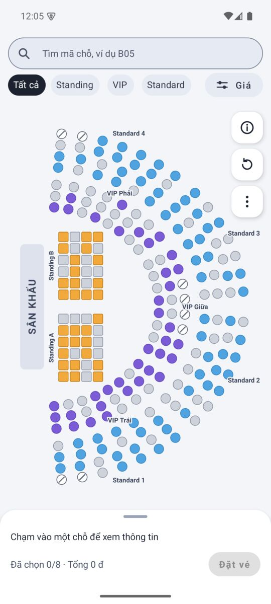
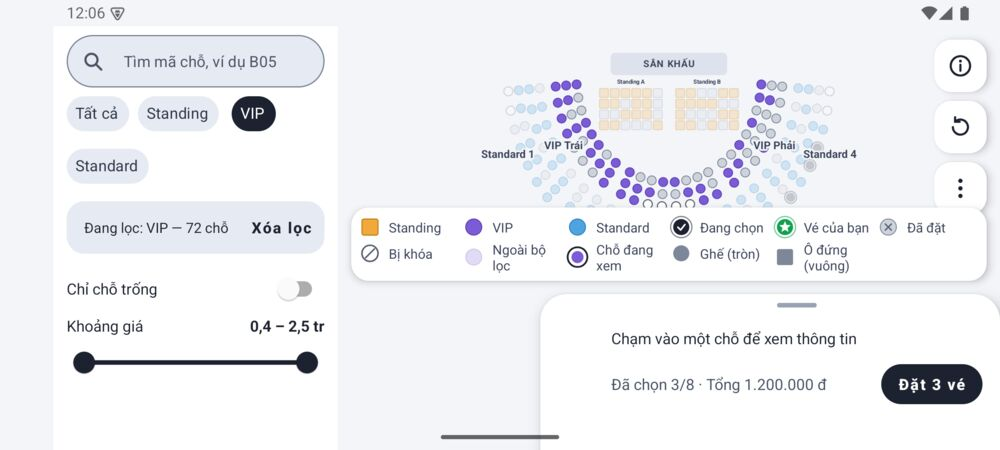

# Concert Seat Map

Ứng dụng Android (Java + XML) hiển thị **sơ đồ chỗ ngồi concert hình móng ngựa** gồm 224 chỗ, vẽ trên **một Canvas duy nhất**. Đây là bài giữa kỳ môn Phát triển ứng dụng di động. Dữ liệu là dữ liệu giả lập, không có API hay cơ sở dữ liệu.

| | |
|---|---|
| Repository | https://github.com/habaodunggithub/Mobile-Midterm-Project |
| Video minh họa | _chưa cập nhật_ |
| Nền tảng | Android 7.0 (API 24) trở lên, `compileSdk`/`targetSdk` 37 |
| Ngôn ngữ | Java 11 + XML Views (không dùng Kotlin, Compose hay thư viện bản đồ/zoom bên thứ ba) |

## 1. Mô tả đề tài

Sơ đồ có sân khấu ở một đầu, hai bãi **Standing** (ô đứng vuông) ngay trước sân khấu, rồi vành cung **VIP** và vành cung **Standard** (ghế tròn) bao quanh. Tổng cộng **224 chỗ** chia thành 9 phân khu:

| Khu | Phân khu | Số chỗ | Hình |
|---|---|---|---|
| Standing | Standing A, Standing B | 48 (2 × 24 ô) | ô đứng vuông |
| VIP | VIP Trái, VIP Giữa, VIP Phải | 72 (3 × 24 ghế) | ghế tròn |
| Standard | Standard 1 đến 4 | 104 (4 × 26 ghế) | ghế tròn |

Mỗi chỗ có một trong năm trạng thái hiển thị: **Còn trống**, **Đang chọn**, **Đã đặt**, **Bị khóa** và **Vé của bạn**. Khoảng 1/3 số chỗ đã có người đặt khi mở app lần đầu, 8 ghế bị khóa ở các cụm cố định.

### Chức năng

| Nhóm | Chức năng |
|---|---|
| Xem sơ đồ | Sơ đồ móng ngựa có phân khu, lối đi và nhãn; bảng chú thích (nút ⓘ) giải thích màu và ký hiệu |
| Điều hướng | Kéo một ngón để **Pan** (có giới hạn biên và quán tính); **Pinch-to-Zoom** quanh tâm hai ngón với mức nhỏ nhất và lớn nhất; xoay sơ đồ bằng hai ngón (tự chỉnh thẳng khi nhấc tay, nút la bàn để về góc mặc định); **Reset View** |
| Chọn chỗ | Chạm để chọn hoặc bỏ chọn, tối đa 8 chỗ; chạm vào chỗ không chọn được thì hiện lý do bằng Snackbar |
| Lọc và tìm kiếm | Theo khu, theo mã chỗ (khớp một phần, không phân biệt hoa thường), "Chỉ chỗ trống", khoảng giá; các tiêu chí kết hợp bằng AND; chỗ ngoài bộ lọc bị làm mờ nhưng lựa chọn được giữ nguyên |
| Bottom Sheet | Thu gọn hiện chỗ đang xem và tóm tắt lựa chọn; mở rộng hiện danh sách "Đang chọn" và "Vé của bạn"; bấm dòng để định vị chỗ trên sơ đồ, bấm ✕ để bỏ chọn; đồng bộ hai chiều với sơ đồ |
| Đặt vé | Nút "Đặt N vé", hộp thoại xác nhận, chỗ đã đặt thành "Vé của bạn" |
| Lưu dữ liệu | Lựa chọn và vé của bạn được lưu bằng `SharedPreferences` và còn lại sau khi tắt hẳn app; nút ⋮ → "Làm mới dữ liệu" để xóa |
| Xoay màn hình | Giữ nguyên chỗ đang xem, bộ lọc, góc nhìn, bảng chú thích, hộp thoại; bố cục riêng cho máy ngang (panel lọc bên trái, bảng chi tiết 420dp) |

### Ảnh chụp màn hình

Chụp trên emulator Pixel 6 (Android 15).

| Dọc, mặc định | Dọc, đã zoom, bảng chi tiết mở rộng | Hộp thoại đặt vé |
|:---:|:---:|:---:|
|  |  |  |

Ngang: panel lọc bên trái, bảng chi tiết rộng 420dp ở góc dưới phải, bảng chú thích đang mở, bộ lọc VIP đang bật.



## 2. Hướng dẫn chạy

**Yêu cầu:** Android Studio bản mới (kèm JDK 17 và Android SDK 37), hoặc JDK 17 và Android SDK cài sẵn nếu chạy bằng dòng lệnh. Mã nguồn được biên dịch ở mức Java 11.

**Bằng Android Studio:** mở thư mục dự án (thư mục chứa `settings.gradle.kts`), đợi Gradle đồng bộ, chọn một thiết bị ảo hoặc máy thật (Android 7.0 trở lên), bấm **Run**.

**Bằng dòng lệnh** (trong thư mục dự án; cần `local.properties` trỏ tới Android SDK, Android Studio tự tạo file này):

```bash
./gradlew assembleDebug    # build, ra app/build/outputs/apk/debug/app-debug.apk
./gradlew installDebug     # cài lên thiết bị hoặc emulator đang kết nối
./gradlew test             # chạy unit test JUnit trên JVM
./gradlew lint             # kiểm tra lint
```

**Cách thao tác:**

- Kéo một ngón: di chuyển sơ đồ. Vuốt nhanh rồi thả: sơ đồ trượt tiếp.
- Hai ngón chụm hoặc nở: zoom. Xoay hai ngón: xoay sơ đồ. Nút ⟲: Reset View. Nút la bàn (hiện khi sơ đồ lệch góc): về góc mặc định.
- Chạm vào chỗ: chọn hoặc bỏ chọn. Kéo bảng chi tiết ở đáy lên hoặc bấm phần đầu để mở rộng.
- Nút ⓘ: bảng chú thích. Nút ⋮: "Làm mới dữ liệu".

## 3. Kiến trúc mã nguồn

Dữ liệu đi một chiều và phụ thuộc chỉ đi xuống: `ui/` → `map/`, `storage/` → `state/` → `model/`. Các package `model`, `data`, `state` và các lớp tính toán của `map` là **Java thuần** (không import `android.*`) nên test được bằng JUnit trên JVM.

```
com.example.midtermproject
├── model/    Venue, Section, Spot, ZoneType, SpotKind, SpotStatus, DisplayState, SelectionResult
│             Thực thể bất biến, chỉ là dữ liệu.
├── data/     MockVenueFactory, SpotStatusPolicy
│             Sinh sơ đồ giả lập từ một seed cố định.
├── state/    VenueMapState, SpotFilter, SessionStore, SessionData, SessionCodec
│             Nguồn sự thật duy nhất của phần người dùng thay đổi được. Java thuần.
├── map/      MapCamera, HitTester, RotationTracker, FlingDecay        (Java thuần)
│             VenueMapView, VenueRenderer, SpotRenderer                 (android.*)
│             Camera và hình học thuần; lớp View và lớp vẽ tách riêng.
├── storage/  PrefsSessionStore
│             Hiện thực SessionStore bằng SharedPreferences.
└── ui/       MainActivity, DetailSheet, FilterBar, LegendCard,
              SpotListAdapter, BookingConfirmDialog, ResetDataDialog, PriceFormatter
```

| Lớp | Vai trò |
|---|---|
| `VenueMapView` | Custom View duy nhất vẽ sơ đồ (4 constructor cùng gọi `init()`); lo cử chỉ (pan, zoom, xoay, chạm), animation camera, và chỉ ghép các lớp bên dưới |
| `MapCamera` | Giữ `scale`, `angle`, `tx`, `ty` bằng `float`; pan, zoom, xoay, kẹp biên, fit, đổi tọa độ hai chiều. Không dùng `android.graphics.Matrix` nên test được trên JVM |
| `VenueRenderer`, `SpotRenderer` | Vẽ nền, sân khấu, từng chỗ theo trạng thái, tên phân khu. Mọi `Paint` và `Path` dựng sẵn trong constructor |
| `HitTester` | Tìm chỗ dưới điểm chạm (chỉ hình học) |
| `VenueMapState` | Lựa chọn, vé của bạn, chỗ đang xem, bộ lọc; mọi thay đổi đi qua các hàm của nó rồi báo `Listener` (mô hình Observer) |
| `DetailSheet`, `FilterBar`, `LegendCard` | Điều khiển các view XML; chỉ đọc từ `VenueMapState`, không giữ bản sao dữ liệu |
| `MainActivity` | Ghép các mảnh, nhận cú chạm từ sơ đồ, lưu và khôi phục trạng thái |

Các quyết định kiến trúc chính:

- **Một Custom View, không có View cho từng chỗ.** `VenueMapView` kế thừa `View` và vẽ cả 224 chỗ trong `onDraw`; phần vẽ tách sang `VenueRenderer`/`SpotRenderer` để View chỉ còn lo cử chỉ và camera.
- **Camera giữ số, không giữ `Matrix`.** Công thức tường minh và test được bằng JUnit; `Matrix` chỉ được dựng lúc vẽ từ `scale`, `angle`, `tx`, `ty`.
- **Cử chỉ:** `GestureDetector` cho kéo một ngón và chạm (`onSingleTapUp`, phản hồi tức thì, không chờ chạm đúp); zoom và xoay hai ngón tự đo, vì `ScaleGestureDetector` chỉ bắt đầu khi hai ngón cách nhau tối thiểu `getScaledMinimumScalingSpan()` (đo được 446px trên emulator Android 15) nên zoom bị trễ rõ rệt.
- **Bottom Sheet:** `CoordinatorLayout` + `BottomSheetBehavior` (persistent sheet, sơ đồ vẫn chạm được khi sheet mở). Hai hộp thoại xác nhận là `DialogFragment` nên `FragmentManager` tự tạo lại sau khi xoay.
- **Bố cục dọc và ngang** dùng chung các file include (`view_map_layers`, `view_bottom_sheet`, `view_price_controls`, `view_filter_status`) với **cùng bộ id**, nên `MainActivity` không cần biết hướng màn hình. `layout-land/` chỉ khác ở vị trí các khối.

## 4. Cách tổ chức dữ liệu

### Mô hình (bất biến)

| Lớp | Thuộc tính chính |
|---|---|
| `Venue` | kích thước sơ đồ 780 × 520 (đơn vị sơ đồ), hình sân khấu, `List<Section>`, `List<Spot>` (theo thứ tự vẽ), tra cứu theo mã bằng `findSpot(id)` |
| `Section` | `id` (`STA-A`, `VIP-T`, `VIP-G`, `VIP-P`, `STD-1`…`STD-4`), `name`, `zone`, vị trí nhãn `labelX/labelY` |
| `Spot` | `id` (ví dụ `VIP-T-A05`), `sectionId`, `zone`, `kind` (`SEAT` hoặc `STANDING_CELL`), `rowLabel`, `number`, `label` (`A05`, tính sẵn để vẽ), `baseStatus`, `price` (đồng), tâm `cx/cy` và `size` |

Hình học của chỗ lưu bằng `float` thuần (không dùng `RectF` hay `Path`) để chạy được trong JUnit. `Spot.baseStatus` (`AVAILABLE`, `BOOKED`, `LOCKED`) là dữ liệu gốc và **không bao giờ đổi**; trạng thái hiển thị (`DisplayState`) được suy ra từ nó và từ `VenueMapState`:

| Ưu tiên | Điều kiện | Hiển thị |
|---|---|---|
| 1 | có trong vé của bạn | `MINE` (ngôi sao xanh lục) |
| 2 | `baseStatus == BOOKED` | `BOOKED` (xám, dấu ✕) |
| 3 | `baseStatus == LOCKED` | `LOCKED` (nền trắng, gạch chéo) |
| 4 | có trong lựa chọn | `SELECTED` (mực xanh đen, dấu ✓) |
| 5 | còn lại | `AVAILABLE` (màu theo khu) |

Hai lớp phủ độc lập: **ngoài bộ lọc** (vẽ mờ, giữ nguyên hình dạng) và **đang xem** (vòng sáng quanh chỗ). Vì chỉ suy ra, bỏ chọn một chỗ thì nó tự trở về đúng dáng vẻ cũ.

### Dữ liệu giả lập

`MockVenueFactory.create()` dựng cùng một sơ đồ mỗi lần (seed `2026`):

- **Standing:** hai khối 4 hàng × 6 ô, bước 24 đơn vị. **VIP:** 3 phân khu × 3 hàng × 8 ghế. **Standard:** 4 phân khu × 4 hàng (6, 6, 7, 7 ghế). Ghế xếp trên vành cung hơi oval quanh tâm mép dưới sân khấu: `x = cx0 + 0,9·r·cosθ`, `y = cy0 + 1,04·r·sinθ`; hàng A gần sân khấu nhất.
- **Giá theo khu và hàng** (gần sân khấu thì đắt hơn): Standing 1,2 → 0,9 triệu; VIP 2,5 → 1,9 triệu; Standard 0,7 → 0,4 triệu.
- **Trạng thái gốc:** 8 ghế `LOCKED` ở các cụm cố định (VIP Giữa hàng C ghế 3–6, Standard 1 hàng D ghế 1–2, Standard 4 hàng D ghế 6–7); các chỗ còn lại bốc bằng `new Random(2026)`, ngưỡng 0,34 cho `BOOKED` (khoảng 1/3 số chỗ, trong khoảng 60 đến 90).
- `MockVenueFactoryTest` kiểm: đúng 224 chỗ, mã không trùng, không hai chỗ chồng nhau, mọi chỗ nằm trong sơ đồ, hai lần gọi cho cùng kết quả.

### Dữ liệu lưu giữa các lần mở app

Chỉ có **lựa chọn** (giữ thứ tự chọn) và **vé của bạn**, ghi bằng `SharedPreferences` (tệp `venue_session`) qua `SessionStore`:

| Khóa | Kiểu | Ví dụ |
|---|---|---|
| `selected_ids` | `String`, mã nối bằng dấu phẩy | `"VIP-T-A05,STD-2-D07"` |
| `my_ticket_ids` | `String` | `"STA-A-A01"` |

Dùng chuỗi nối thay vì `StringSet` vì `StringSet` không giữ thứ tự mà lựa chọn cần giữ thứ tự chọn. Ghi bằng `apply()` nên không chặn giao diện. Dữ liệu đọc lên (có thể cũ hoặc hỏng) luôn đi qua `VenueMapState.restore`, hàm này bỏ mã không tồn tại, mã trùng, chỗ không còn trống và chỗ vừa chọn vừa là vé, nên app không crash vì dữ liệu hỏng.

## 5. Công thức chuyển đổi tọa độ

Có hai hệ tọa độ: **tọa độ sơ đồ** (world, đơn vị riêng, gốc ở góc trên trái của sơ đồ 780 × 520, trục y hướng xuống) và **tọa độ màn hình** (px của `VenueMapView`). Quy ước: góc dương là **theo chiều kim đồng hồ trên màn hình**, giống `Matrix.postRotate` của Android.

`MapCamera` giữ bốn số: tỉ lệ `s`, góc `θ` (radian) và độ dịch `t = (tx, ty)` (px). Phép biến đổi:

```
screen = s · R(θ) · world + t         R(θ) = [ cosθ  −sinθ ]
                                             [ sinθ   cosθ ]

world  = R(−θ) · (screen − t) / s     (chiều ngược lại, dùng khi chạm)
```

Trong code (`MapCamera.worldToScreenX/Y` và `screenToWorldX/Y`), hai chiều đều cần **cả hai tọa độ** vì có xoay:

```java
screenX = s * (wx * cosθ - wy * sinθ) + tx;
screenY = s * (wx * sinθ + wy * cosθ) + ty;

dx = (sx - tx) / s;  dy = (sy - ty) / s;
worldX =  dx * cosθ + dy * sinθ;
worldY = -dx * sinθ + dy * cosθ;
```

Khi vẽ, `VenueMapView` dựng `Matrix` từ chính bốn số này (`setScale(s, s)`, `postRotate(θ°)`, `postTranslate(tx, ty)`) rồi `canvas.concat(matrix)`. Vì hit-test và việc vẽ dùng chung một công thức nên không thể lệch nhau.

| Thao tác | Công thức | Ý nghĩa |
|---|---|---|
| **Pan** | `t' = t + (dx, dy)`, rồi kẹp biên | kéo bao nhiêu px thì dịch bấy nhiêu |
| **Zoom** hệ số `k` quanh điểm `f` | `s' = clamp(s·k)`, `t' = f − (s'/s)·(f − t)` | điểm sơ đồ nằm dưới `f` (tâm hai ngón) đứng yên |
| **Xoay** góc `Δ` quanh `f` | `θ' = θ + Δ`, `t' = f − R(Δ)·(f − t)` | điểm sơ đồ dưới `f` đứng yên |
| **Fit** | `min((W − 2p)/Wθ, (H − bottomInset − 2p)/Hθ)`, `p = 16dp` | sơ đồ vừa vùng nhìn ở góc `θ`; `Wθ = W|cosθ| + H|sinθ|`, `Hθ = W|sinθ| + H|cosθ|` là khung bao của sơ đồ đã xoay |
| **Giới hạn zoom** | nhỏ nhất = Fit tại góc hiện tại, lớn nhất = `6 ×` Fit tại góc mặc định | tại mức lớn nhất một ghế to khoảng 42dp |
| **Kẹp biên** | mép khung bao chỉ được lùi vào trong mép vùng nhìn tối đa 48dp | không kéo sơ đồ ra khỏi màn hình; nếu khung bao nhỏ hơn vùng nhìn thì căn giữa |

Góc mặc định là `−90°` khi màn hình dọc (sân khấu bên trái, để sơ đồ lấp đầy chiều cao) và `0°` khi ngang (sân khấu ở trên). `bottomInset` là chiều cao bảng chi tiết đang thu gọn: sơ đồ được căn giữa phía trên bảng.

Xoay hai ngón dùng `RotationTracker` (Java thuần): từ hai điểm chạm tính góc đường nối bằng `atan2`, trả độ lệch so với lần trước, chuẩn hóa về `(−π, π]` để không nhảy 360° khi đi qua trục ±180°. Sơ đồ chỉ bắt đầu xoay khi đường nối quay quá 6°, và tự chỉnh thẳng nếu nhấc tay trong ±8° quanh một góc vuông.

## 6. Phương pháp hit-testing

Khi người dùng chạm, `VenueMapView.handleTap` làm ba bước:

1. Đổi điểm chạm từ màn hình sang tọa độ sơ đồ bằng `MapCamera.screenToWorldX/Y` (công thức ngược ở mục 5, đã tính cả pan, zoom và xoay hiện tại).
2. Tính dung sai bằng **dp rồi chia cho tỉ lệ**: `tolerance = 8dp · density / s`. Chia cho `s` để vùng nới luôn là 8dp trên màn hình ở mọi mức zoom (nếu quên thì khi zoom lớn vùng nới phình ra gấp nhiều lần và chạm lệch vẫn "trúng").
3. `HitTester.findSpotAt` duyệt các chỗ, dùng `Spot.hitTest`:

```java
dx = wx - cx;  dy = wy - cy;  reach = size + tolerance;
ghế tròn:   dx*dx + dy*dy <= reach*reach     // khoảng cách tới tâm
ô đứng:     |dx| <= reach && |dy| <= reach   // ô vuông không xoay trong tọa độ sơ đồ
```

Nếu điểm chạm nằm trong vùng của nhiều chỗ (ở mức Fit, vùng đã nới của các chỗ kề nhau chồng lên nhau) thì chọn chỗ có **tâm gần điểm chạm nhất**. Không trúng chỗ nào (lối đi, sân khấu) thì báo "chạm vào chỗ trống" và bỏ chỗ đang xem.

Vì hit-test làm trong **tọa độ sơ đồ** sau khi đổi ngược toàn bộ phép biến đổi, ghế vẫn tròn và ô đứng vẫn vuông bất kể sơ đồ đang xoay thế nào, nên hit-test đúng ở mọi góc nhìn chứ không chỉ ở góc mặc định. Bằng chứng nằm ở các test `ac3_9_*`, ví dụ `HitTesterTest.ac3_9_correctAfterPanAndZoom` và `ac3_9_correctAfterZoomAroundAnOffCenterFocusAndRotation`: với 3 góc xoay (0°, −90°, 37°), 3 mức zoom và 4 độ pan (36 cấu hình), mọi chỗ đang nằm trong màn hình được chạm lệch tâm 6 hướng (cách tâm 0,45 bán kính trên màn hình) và phải trả về đúng chỗ đó.

`HitTester` chỉ làm hình học, xét **mọi** chỗ. Việc được phép chọn hay không (chỗ đã đặt, bị khóa, ngoài bộ lọc, quá 8 chỗ) là quy tắc nghiệp vụ nằm trong `VenueMapState.toggleSelection`, nên chạm vào chỗ không chọn được vẫn nhận ra chỗ đó để báo lý do.

## 7. Quản lý trạng thái

**Tách ba lớp:** dữ liệu (`model/`, `data/`: sơ đồ bất biến), trạng thái (`state/`: phần người dùng thay đổi) và lớp vẽ (`map/`, `ui/`). Dữ liệu đi một chiều: *chạm → `VenueMapState` → báo `Listener` → sơ đồ và bảng chi tiết cùng vẽ lại*. Sơ đồ, bộ lọc và bảng chi tiết **chỉ đọc** từ state, không giữ bản sao riêng, nên chúng không thể lệch nhau (đồng bộ hai chiều).

`VenueMapState` giữ: các chỗ đang chọn (`LinkedHashSet`, giữ thứ tự chọn, tối đa 8), vé của bạn, chỗ đang xem và bộ lọc (`SpotFilter` bất biến, mỗi lần đổi tạo bản mới). Mọi thay đổi đi qua các hàm lệnh `toggleSelection`, `removeSelection`, `setFocused`, `setFilter`, `bookSelection`, `restore`, `resetAll`; mỗi hàm báo `Listener` đúng một lần. Các bất biến luôn đúng: lựa chọn và vé không giao nhau; chỗ đã chọn đều có trạng thái gốc `AVAILABLE`; không quá 8 chỗ; chỗ đang xem là `null` hoặc có thật.

Quy tắc chọn nằm trong `toggleSelection`, trả về `SelectionResult` để giao diện báo lý do: vé của bạn, đã đặt, bị khóa, ngoài bộ lọc, hoặc đã đủ 8 chỗ (chỉ bỏ chọn được qua nút ✕ trong bảng chi tiết nếu chỗ đã ra ngoài bộ lọc). Chạm vào chỗ không chọn được thì chỗ đó vẫn thành "chỗ đang xem".

### Giữ trạng thái khi xoay màn hình

Mỗi dữ liệu chỉ có **một nguồn**:

| Dữ liệu | Nơi giữ | Vì sao |
|---|---|---|
| Lựa chọn (giữ thứ tự) và vé của bạn | `SharedPreferences` qua `SessionStore`, ghi mỗi khi một trong hai đổi | còn lại cả khi tắt hẳn app (AC-7.5) |
| Chỗ đang xem, bộ lọc, ảnh chụp góc nhìn, bảng chú thích | `Bundle` trong `onSaveInstanceState` | chỉ cần qua xoay màn hình và khi hệ thống hủy Activity |
| Bảng chi tiết mở rộng hay thu gọn | `BottomSheetBehavior` tự lưu | |
| Hộp thoại xác nhận | `FragmentManager` dựng lại từ `arguments` | |

`onCreate` sinh lại sơ đồ từ cùng seed, đọc `SessionStore`, lấy thêm chỗ đang xem và bộ lọc từ `Bundle` (nếu có), rồi gọi `VenueMapState.restore` **đúng một lần**; hàm này loại mọi mã sai nên dữ liệu hỏng không làm app crash. Các control lọc được vẽ từ state, và đặt `android:saveEnabled="false"` để Android không tự khôi phục chip, chữ tìm kiếm, công tắc, thanh giá bằng giá trị cũ (nếu không thì bộ lọc có hai nguồn).

**Góc nhìn** được lưu dưới dạng `{điểm sơ đồ ở tâm vùng nhìn (x, y), tỉ lệ so với Fit}`, **không lưu `tx, ty` thô**, vì sau khi xoay máy kích thước vùng nhìn đã khác: cùng một `tx, ty` sẽ chỉ vào chỗ khác. Góc xoay không lưu, sau khi tạo lại sơ đồ về góc mặc định của hướng mới. `VenueMapView` áp ảnh chụp ngay khi đo xong kích thước; ảnh hỏng thì dùng Fit.

## 8. Tối ưu hiệu năng

- **Không cấp phát trong `onDraw`:** mọi `Paint`, `Path`, `Matrix`, `RectF` và mảng tạm được dựng sẵn khi khởi tạo (`VenueRenderer`, `SpotRenderer`, `VenueMapView`); nhãn chỗ (`A05`) là `String` tính sẵn trong `Spot`; không nối chuỗi hay `String.format` lúc vẽ. `./gradlew lint` không có cảnh báo `DrawAllocation`.
- **Chỉ vẽ lại khi cần:** `invalidate()` chỉ được gọi khi camera đổi (cử chỉ, animation) hoặc khi `VenueMapState` báo thay đổi; animation dùng `postInvalidateOnAnimation()`.
- **Culling:** mỗi khung hình `MapCamera.getVisibleWorldBounds` trả về khung bao của vùng nhìn trong tọa độ sơ đồ (bốn góc màn hình đổi ngược về sơ đồ, có tính cả xoay); `VenueRenderer` bỏ qua các chỗ nằm hẳn ngoài khung này (có lề 24dp cho vòng sáng và viền). Khi zoom lớn chỉ còn vài chục chỗ được vẽ.
- **Mức chi tiết (LOD):** mã chỗ, dấu ✓ ✕ ★ chỉ vẽ khi chỗ đủ to trên màn hình (đường kính từ 22dp); gạch chéo của chỗ bị khóa từ 9dp. Ở mức Fit chỉ vẽ hình tròn hoặc vuông.
- **Cắt theo khung:** `onDraw` tự `clipRect` theo khung của View, và chữ tên phân khu vẽ trong tọa độ màn hình nên luôn cùng cỡ.
- **Phần cứng:** vẽ bằng `View` thường nên được tăng tốc bởi GPU; 224 chỗ không cần `SurfaceView`.
- **Số đo** (`dumpsys gfxinfo`, emulator Pixel 6 API 35, pinch và pan liên tục 5 vòng, 390 khung hình): trung vị 16 ms, 90% dưới 23 ms, 99% dưới 32 ms; 80% số khung trong 17 ms; thời gian GPU trung vị 11 ms. Đây là số đo trên emulator (GPU giả lập), chưa đo trên máy thật.
